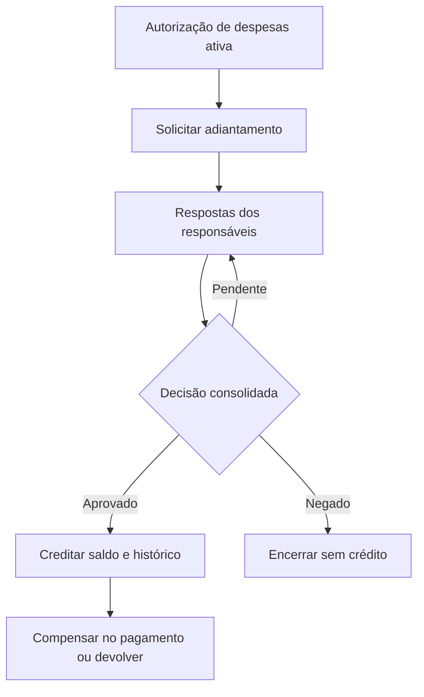

# Fluxo de adiantamentos e devoluções

[Voltar ao manual](../README.md) · [Telas financeiras](../telas/05-despesas-financeiro.md)

## Quando utilizar

Use o adiantamento quando o colaborador precisa receber um valor antes do fechamento e pagamento das despesas. O saldo registra o valor que ainda pode ser utilizado na compensação de reembolsos ou devolvido.

A solicitação, a aprovação e o recebimento no mundo real são eventos diferentes. O ERP altera o saldo ao consolidar a aprovação da autorização; não executa uma transferência bancária.

## Preparação

Antes da primeira solicitação, o administrador deve:

1. Cadastrar a pessoa, seu e-mail e filial e conceder acesso ao sistema e às telas de despesas.
2. Manter o tipo de autorização de despesa, adiantamento e devolução e suas regras de aprovação.
3. Em **Pessoas → Equipe**, cadastrar responsáveis superiores para os tipos correspondentes. Apenas adicionar uma pessoa à equipe sem marcar os tipos não define todos os aprovadores.
4. Configurar o termo de consentimento do adiantamento, se aplicável.
5. Para solicitar adiantamento, garantir que exista autorização de despesas aprovada e ativa do colaborador.

## Solicitação e aprovação do adiantamento

1. O colaborador abre **Despesas → Solic. Adiantamento**.
2. Escolhe a autorização de despesa, informa valor e motivo e confere os responsáveis.
3. Aceita o termo quando houver texto configurado. O texto é gravado na solicitação para preservar o conteúdo aceito.
4. Ao cadastrar, o sistema cria a solicitação e os registros de resposta dos responsáveis. Tenta enviar e-mail ao solicitante e aos responsáveis.
5. O responsável abre **Autorizações**, confere os dados e responde. Negativa exige motivo.
6. Ao obter decisão final positiva, o sistema acrescenta o valor ao saldo, grava histórico com saldos anterior/posterior e registra uma saída financeira de adiantamento.
7. Autorizações de adiantamento com decisão final são encerradas como ativas para tramitação; permanecem consultáveis como aprovadas ou negadas.

**Validações:** autorização de despesa e motivo são obrigatórios; valor deve ser numérico e de pelo menos R$ 0,01; não pode faltar responsável. A tela usa as autorizações de despesas ativas/aprovadas do usuário como opções.

Se o cadastro foi salvo, mas o e-mail falhou, consulte a listagem antes de enviar outra solicitação. O aviso de falha de comunicação não significa necessariamente que não houve cadastro.

## Como as respostas são consolidadas

| Regra do tipo | Quando aprova | Quando nega | Enquanto aguarda |
|---|---|---|---|
| Todos | Todos os responsáveis responderam sim e nenhum respondeu não | Há pelo menos uma resposta não | Ainda há respostas pendentes sem negativa |
| Uma aprovação | Há pelo menos uma resposta sim e nenhuma negativa registrada | Há resposta não registrada na consolidação | Não há resposta decisiva |

A decisão final impede novas respostas pelo fluxo normal de pendências. Não se deve interpretar “uma aprovação” como uma votação por maioria. A lista de responsáveis é criada no envio da solicitação; alterar a equipe depois não recria automaticamente os responsáveis de uma solicitação já enviada.

## Uso do saldo nos lotes

O colaborador lança despesas e gera um lote. Na versão atual, **gerar lote não reduz o saldo**. **Aprovar o lote na conferência também não reduz o saldo**. A compensação ocorre na confirmação da baixa em **Financeiro → Pagamentos de Lotes**.

O sistema utiliza o menor valor entre o saldo positivo do colaborador e o reembolso líquido do lote. A diferença, quando positiva, é registrada como valor pago. Consulte [cálculos e exemplos](pagamentos.md).

Por isso, um saldo visto antes de registrar pagamentos de lotes pendentes ainda pode estar comprometido com esses pagamentos. Confirme as pendências antes de solicitar a devolução ou fazer ajustes manuais.

## Solicitar devolução de saldo

1. Realize o depósito/devolução conforme o procedimento financeiro da empresa e obtenha um comprovante legível. O ERP não efetua esse depósito.
2. Abra **Despesas → Dev. Adiantamento**.
3. Confira o saldo exibido. Informe o valor a devolver e o motivo.
4. Anexe o **Comprovante de Devolução**, obrigatório: JPG/JPEG, PNG ou PDF, até 20 MB.
5. Confira os responsáveis pela aprovação e cadastre.
6. Aguarde a análise em Autorizações. O arquivo fica disponível nos detalhes da solicitação e na consulta geral de autorizações.

A tela bloqueia a solicitação quando não há saldo positivo ou aprovador. O servidor exige valor mínimo de R$ 0,01 e máximo igual ao saldo atual e impede outra solicitação de devolução ativa para a mesma pessoa.

O valor digitado é positivo no formulário; internamente a devolução é registrada com valor negativo na autorização. O histórico de consulta pode apresentar o valor em módulo para facilitar a leitura.

A gravação associa autorização, comprovante e responsáveis dentro de transação de banco. Se falhar após o armazenamento, o arquivo enviado é removido. Registros anteriores à implantação desse recurso podem não ter comprovante.

## Analisar e concluir a devolução

O responsável configurado para **devolução de adiantamento** abre a solicitação em Autorizações, consulta o arquivo e confere valor e motivo. A validação real da existência do depósito deve seguir o procedimento da empresa; o arquivo anexado sozinho não comprova conciliação bancária.

Ao aprovar e concluir a regra de aprovação, o sistema reduz o saldo, grava o histórico e registra uma entrada no fluxo de caixa com a descrição **Devolução de Adiantamento**. Ao negar, não reduz o saldo por essa solicitação.

**Comportamento atual:** não existe uma segunda fila específica de aprovação de depósitos em Financeiro → Adiantamentos. A aprovação é a de Autorizações. Também não há envio automático de e-mail no cadastro da devolução nessa revisão; a resposta à autorização tenta notificar os envolvidos.

## Ajustes manuais no financeiro

Em **Financeiro → Adiantamentos**, o financeiro pode escolher um colaborador e usar:

| Ação | Saldo do colaborador | Fluxo de caixa |
|---|---|---|
| Pagar | Aumenta pelo valor informado | Saída financeira |
| Estornar | Diminui pelo valor informado | Entrada financeira |

Valor zero é recusado e o motivo é obrigatório. Esses ajustes já gravam movimento. Não use Pagar para repetir o crédito de uma solicitação que já foi aprovada, nem Estornar para repetir uma devolução já concluída. A rotina de ajuste não vincula automaticamente o lançamento a um comprovante de depósito.

## Histórico e conferência do saldo

O histórico acessado pelo financeiro mostra data, descrição, saldo anterior, valor da movimentação e saldo posterior. Os movimentos podem se originar de autorização aprovada, devolução, ajuste manual ou abatimento no pagamento de lote.

A fórmula operacional é:

**Saldo final = saldo anterior + adiantamentos aprovados + ajustes de aumento − devoluções aprovadas − ajustes de redução − adiantamento utilizado nos pagamentos.**

Exemplo:

| Movimento | Variação do saldo | Saldo |
|---|---:|---:|
| Adiantamento aprovado | + R$ 1.000,00 | R$ 1.000,00 |
| Pagamento de lote com reembolso líquido de R$ 600,00 | − R$ 600,00 | R$ 400,00 |
| Devolução de R$ 400,00 apenas solicitada | R$ 0,00 | R$ 400,00 |
| Devolução aprovada | − R$ 400,00 | R$ 0,00 |

Ao atingir zero, o registro de saldo corrente pode ser removido da tabela de saldos; o histórico continua sendo o registro das movimentações. Não existe, nesta revisão, bloqueio geral no helper que force todos os saldos a permanecerem positivos. Divergências ou saldos negativos exigem análise do histórico, especialmente de ajustes e operações simultâneas.

## Limite em relação ao extrato proposto

O histórico atual não contém todos os lotes aprovados: o registro de lote nele corresponde ao abatimento de saldo no pagamento, quando houver abatimento. Não existe a nova tabela/consulta de extrato com tipos 1-lote, 2-adiantamento e 3-devolução, datas de aprovação e pagamento e acesso por colaborador conforme o documento de nova rotina.

O comprovante obrigatório implementa o anexo da devolução. Isso, por si só, não implementa o extrato nem a nova validação financeira em outra tela.

## Referências da revisão

[Solicitação](../../../app/Http/Controllers/Authorization/AuthorizationCashAdvanceController.php), [devolução](../../../app/Http/Controllers/Authorization/AuthorizationCashAdvanceReturnController.php), [resposta dos responsáveis](../../../app/Http/Controllers/Me/AuthorizationController.php), [consolidação](../../../app/Helpers/AuthorizationHelper.php), [saldo e histórico](../../../app/Helpers/UserHelper.php), [ajustes financeiros](../../../app/Http/Controllers/Finance/CashAdvanceController.php), [estrutura do histórico](../../../database/migrations/2023_12_04_204750_create_users_cash_history_table.php).
