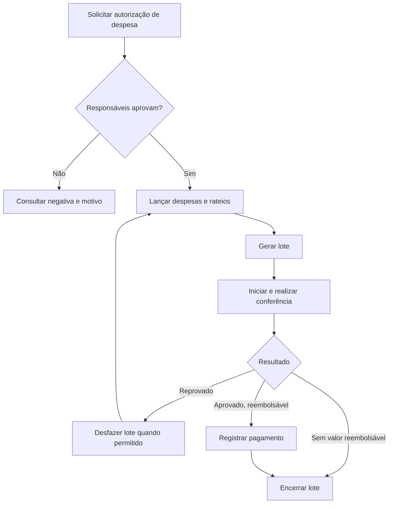

# Fluxo de despesas, lotes e conferência

[Voltar ao manual](../README.md) · [Pagamento e cálculos](pagamentos.md)

## Visão geral

## 1. Solicitar autorização de despesas

O colaborador acessa **Solicitação de Despesas**, informa período, motivo e clientes envolvidos. A data final não pode anteceder a inicial. Sem responsáveis configurados para esse tipo, a solicitação não é aceita.

O cadastro cria a autorização, os vínculos de clientes e os registros dos responsáveis que devem responder. A comunicação tenta alcançar o solicitante e os responsáveis. A decisão é dada em **Autorizações**, com as regras “todos” ou “uma aprovação” descritas no [fluxo de adiantamentos](adiantamentos.md).

A autorização de despesas delimita o período e os clientes dos futuros lançamentos. Ela não é um lote, não registra pagamento e não cria saldo de adiantamento por si só.

## 2. Lançar a despesa

Pré-requisito: autorização própria aprovada e ativa.

1. Abra **Cadastro de Despesas** e escolha a autorização.
2. Informe a data dentro do período autorizado, tipo de despesa, valor e tipo de pagamento.
3. Distribua o valor entre os clientes da autorização. Somente clientes vinculados a ela são considerados na gravação.
4. Distribua o valor entre os usuários beneficiados. O usuário do lançamento e os beneficiários do rateio são conceitos diferentes.
5. Anexe o comprovante e observações, quando aplicável.
6. Cadastre e confira o lançamento na lista.

Cada rateio deve totalizar o valor completo da despesa. Por exemplo, uma despesa de R$ 100,00 pode ser distribuída em R$ 60,00 e R$ 40,00 por cliente e, separadamente, R$ 50,00 e R$ 50,00 por usuário. Não se somam os dois rateios para obter R$ 200,00; são duas visões da mesma despesa.

O sistema mantém os valores e percentuais dos rateios e recalcula a combinação cliente × usuário para detalhamento, ajustando a última parcela para fechar o total.

### Comprovante e visibilidade

As categorias oferecidas são do tipo Despesa e respeitam os vínculos de usuário da categoria. A forma de pagamento informa se o gasto é reembolsável. O comprovante admite JPG/JPEG, PNG ou PDF até 20 MB; sua obrigatoriedade nas despesas vem de Configurações Gerais.

A lista de manutenção contém despesas do usuário, sem lote e com autorização ativa. Depois de vinculada a um lote, a despesa deixa essa manutenção. Na edição, a autorização original é mantida; não se troca a autorização por esse formulário.

### Distribuir em vários dias

Na inclusão, a opção **Distribuir** permite escolher a quantidade de dias. A rotina distribui o valor em dias úteis a partir da data informada, desconsiderando sábados e domingos e os feriados da filial quando aplicáveis. O período autorizado é o limite.

O valor é dividido com arredondamento em duas casas decimais; diferenças e valor que não caiba em novos dias dentro do período são acumulados na última parcela gerada. Os rateios por cliente e usuário acompanham proporcionalmente cada parcela e ajustam a última participação para fechar o valor.

Confira a quantidade, as datas e os valores dos lançamentos resultantes, especialmente perto do fim da autorização. Se a distribuição não produzir datas, o controlador mantém um lançamento único conforme a entrada, sujeito à validação original.

## 3. Gerar o lote

Em **Gerar Lote**, o colaborador seleciona uma ou mais despesas elegíveis e confirma. A seleção é obrigatória. A tela reúne despesas próprias sem lote e com autorização ativa.

A geração:

- Cria o código do lote e vincula as despesas selecionadas.
- Registra quantidade e totais gerais, reembolsáveis e não reembolsáveis.
- Consolida valores e quantidades por categoria e cliente.
- Calcula descontos conforme os vínculos, categorias, datas e calendário.
- Calcula o reembolso líquido.
- Tenta avisar os usuários inscritos na notificação Revisão de Lotes.
- Abre os detalhes em **Meus Lotes**.

Não há abatimento de adiantamento nem transferência ao colaborador nessa etapa. Alterações posteriores nos cadastros de descontos não recalculam automaticamente os totais de um lote já gerado pelo fluxo documentado.

O conteúdo de e-mail de novo lote tem uma variação para o próprio colaborador; porém, a rotina de envio da geração percorre os usuários inscritos em Revisão de Lotes. Ela não inclui o solicitante como destinatário adicional de forma incondicional.

## 4. Conferir o lote

O conferente acessa **Financeiro → Conferência de Lotes**. A fila contém lotes ativos com revisão pendente ou em análise.

1. Abra o lote e confira a identificação e o resumo.
2. Use **Iniciar Revisão**. O sistema registra quem iniciou e a data, alterando a situação para Em Revisão.
3. Confira cada despesa, comprovante, data, categoria, rateios e reembolsabilidade. As marcações de revisão de despesa são gravadas pela tela.
4. Se houver reembolso, confira a **Data Agendamento do Pagamento** sugerida e ajuste conforme a necessidade. A sugestão considera dias úteis e a filial de quem está conferindo.
5. Informe anotações que precisem ser comunicadas ao colaborador.
6. Reprove, aprove ou feche o lote conforme sua situação.

A marcação dos itens ajuda a conferência, mas o controlador não exige, na ação final, uma contagem de todos os itens marcados. Não considere essa interface uma garantia de que todos os documentos foram efetivamente verificados.

### Reprovar

**Reprovar Lote** exige motivo em Anotações. O lote volta a revisão pendente, mas conserva a identificação de quem revisou; por isso, a apresentação ao usuário é **Rejeitado**. O sistema tenta enviar a notificação ao colaborador.

A reprovação não exclui despesas e não desfaz automaticamente o lote. Para alterar lançamentos, o colaborador deve seguir a rotina de desfazer, quando permitida.

### Aprovar com valor reembolsável

A ação marca a revisão como aprovada, registra data/responsável, previsão de pagamento e anotações e mantém o lote ativo para pagamento. O colaborador recebe tentativa de e-mail de aprovação com a previsão, quando aplicável.

O saldo do adiantamento ainda não é reduzido. O valor líquido efetivamente pago depende do saldo disponível no momento da baixa.

### Fechar sem valor reembolsável

Quando o total reembolsável é zero, a aprovação encerra o lote diretamente: revisão aprovada, lote inativo, adiantamento utilizado zero e valor pago zero. Esse caminho não efetua pagamento e não preenche a data de pagamento pela mesma ação usada na tela de baixa.

A condição é o **total reembolsável antes dos descontos**. Um lote com despesas reembolsáveis e reembolso líquido zerado pelos descontos ainda segue a aprovação para a etapa de pagamento/encerramento.

## 5. Interpretar a situação

| Situação exibida | Condição principal | O que fazer |
|---|---|---|
| Pendente p/ Análise | Revisão pendente e sem responsável registrado | Aguardar/iniciar conferência |
| Em Revisão | Revisão em análise | Aguardar a conclusão ou terminar a conferência |
| Rejeitado | Revisão pendente, mas há responsável de revisão registrado | Ler motivo e corrigir pelo fluxo permitido |
| Aprovado | Fora das etapas pendente/em análise e ainda ativo | Registrar pagamento/baixa |
| Concluído | Fora das etapas pendente/em análise e inativo | Consultar o resultado; verificar se houve pagamento ou apenas encerramento |

“Concluído” não significa necessariamente transferência bancária: um lote sem reembolso ou totalmente compensado pelo adiantamento também pode terminar sem valor pago.

## 6. Desfazer para corrigir

Em **Meus Lotes**, abra o lote e use **Desfazer Lote** quando disponível. O servidor aceita somente lote próprio, ativo, com revisão pendente, fora de análise e ainda não aprovado. Também bloqueia se alguma despesa tiver autorização inativa.

Ao desfazer:

- As despesas ficam sem lote e com revisão desmarcada.
- O registro do lote é excluído e seus vínculos acompanham as regras de relacionamento do banco.
- A rotina tenta comunicar aos inscritos em Revisão de Lotes que o lote foi desfeito.

Corrija as despesas no cadastro e gere um novo lote. Um código de lote excluído deixa de representar um formulário consultável. Não foi identificada ação normal de reabrir lote aprovado ou pago pelo colaborador.

## 7. Consultar, imprimir e acompanhar

O colaborador usa **Meus Lotes**. O usuário com permissão de consulta geral usa **Consultas → Lotes** para filtrar por período de criação e usuário. As telas exibem despesas, descontos, gráficos e, quando o lote foi baixado, valores utilizados/pagos e data.

A impressão continua acessível antes da aprovação nesta revisão. Um PDF é uma representação dos dados existentes na hora de sua geração, e não confirmação de depósito ou pagamento. A regra proposta de liberar impressão somente após conferência ainda não está implementada.

## Prazos e operações automáticas

Autorizações inativas deixam de permitir manutenção normal de despesas. A rotina diária remove despesas sem lote cuja autorização esteja inativa. Portanto, concluir lançamentos e formar lotes antes do encerramento da autorização é relevante para preservar o fluxo operacional.

Lotes ativos sem valor reembolsável também podem ser encerrados pela tarefa de prazo. A tarefa não gera novos lotes a partir de despesas soltas. Consulte [rotinas automáticas](../operacao/rotinas.md) antes de interpretar o parâmetro de “lote automático”.

## Referências da revisão

[Solicitação](../../../app/Http/Controllers/Authorization/AuthorizationExpenseController.php), [lançamento](../../../app/Http/Controllers/Expense/ExpenseController.php), [validações e rateios](../../../app/Http/Requests/ExpenseRequest.php), [distribuição por dia](../../../app/Helpers/DateTimeHelper.php), [geração/cálculo](../../../app/Helpers/ExpenseHelper.php), [conferência](../../../app/Http/Controllers/Finance/BatchReviewController.php), [situações](../../../app/Models/Batch.php), [desfazer](../../../app/Http/Controllers/Me/BatchController.php), [formulário de conferência](../../../resources/views/batch-review/index.blade.php).
