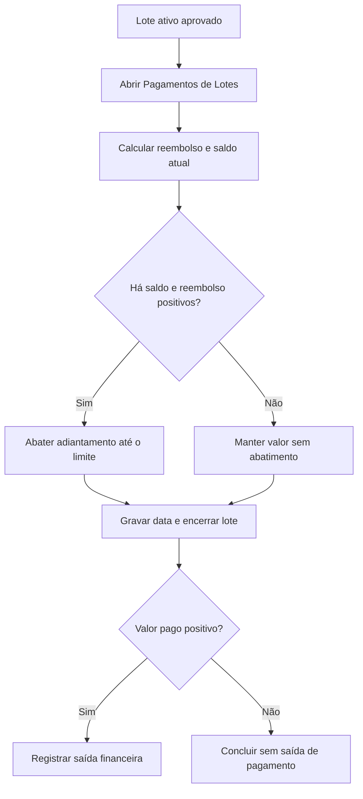

# Fluxo de pagamentos, descontos e compensação

[Voltar ao manual](../README.md) · [Fluxo de lotes](despesas-lotes.md) · [Adiantamentos](adiantamentos.md)

## Separar os valores do lote

| Informação | Cálculo ou origem | Quando é registrada |
|---|---|---|
| Valor total do lote | Soma de todas as despesas do lote | Geração |
| Valor não reembolsável | Despesas com tipo de pagamento não reembolsável | Geração |
| Valor reembolsável | Despesas com tipo de pagamento reembolsável | Geração |
| Desconto do lote | Soma dos descontos calculados para as despesas | Geração |
| Valor do reembolso (`refund_amount`) | Valor reembolsável − desconto | Geração |
| Adiantamento utilizado (`user_cash`) | Menor valor entre saldo positivo e reembolso líquido positivo | Baixa/pagamento |
| Valor pago (`amount_paid`) | Reembolso líquido − adiantamento utilizado | Baixa/pagamento |
| Data de aprovação/revisão | Data da ação de conferência | Conferência |
| Previsão de pagamento | Data sugerida/confirmada na conferência | Conferência |
| Data de pagamento | Data corrente na confirmação da baixa | Baixa/pagamento |

A previsão não executa a baixa automaticamente. Um lote pode continuar pendente após a data prevista até que o financeiro registre a ação. Campos de valor extra existem na estrutura, mas a rotina documentada de pagamento calcula o valor pelo reembolso líquido e pelo saldo, sem uma entrada operacional de acréscimo nessa tela.

## Como os descontos são calculados

O administrador prepara **Descontos**, **Valores Descontos** e **Pessoas → Descontos Lote**. Na geração do lote, cada desconto precisa estar vinculado ao colaborador e à categoria da despesa.

A rotina considera somente despesas reembolsáveis em dias úteis: ignora sábados, domingos e feriados aplicáveis à filial do dono da despesa. O valor do desconto é o da vigência mais recente anterior ou igual à data da despesa; sem vigência aplicável, vale zero.

Para uma mesma data e desconto, o valor é distribuído entre as despesas elegíveis do lote. A parcela de uma despesa não supera o saldo remanescente dessa despesa. Se houver mais de um desconto, as parcelas também consomem esse saldo remanescente. O lote guarda o detalhe de valor de referência, parcela aplicada e despesa de origem.

**Exemplo ilustrativo:** desconto diário de R$ 20,00, duas despesas elegíveis de R$ 12,00 e R$ 30,00 na mesma data. Para esse desconto e lote, a rotina pode aplicar R$ 12,00 na primeira e R$ 8,00 na segunda. A ordem dos itens influencia a distribuição das parcelas; confira o detalhamento, não apenas cada linha isolada.

O controle diário é calculado dentro de cada lote. Não há, nesse cálculo, uma busca global para descontar valores já utilizados em outro lote da mesma pessoa e dia. Não presuma um teto diário entre lotes diferentes.

## Registrar pagamento/baixa

1. O financeiro abre **Pagamentos de Lotes**.
2. Escolhe um lote ativo já aprovado na conferência.
3. Confere os totais e o saldo atual do colaborador.
4. Confirma a ação apresentada pela tela.
5. O sistema recalcula a compensação usando o saldo disponível naquele momento.
6. Se utilizar adiantamento, reduz o saldo e grava histórico com o código do lote. Essa redução não cria outra transação de caixa de adiantamento.
7. Grava data atual, adiantamento utilizado, valor pago e encerra o lote.
8. Tenta enviar o aviso ao colaborador.
9. Quando o valor pago é positivo, registra a transação **Pagamento de Lote** como saída financeira.

O ERP registra a operação; a transferência, o depósito ou a entrega do valor é realizada conforme o procedimento externo da empresa. Não foi identificada integração bancária nesta rotina.

A compensação é feita no pagamento, não reservada na geração nem na conferência. Quando há vários lotes aprovados do mesmo colaborador, a ordem da baixa afeta quanto adiantamento cada lote utiliza.

## Exemplos para conferência

Valores abaixo ilustram reembolso líquido já calculado após descontos.

| Cenário | Saldo antes | Reembolso líquido | Adiantamento utilizado | Valor pago | Saldo depois |
|---|---:|---:|---:|---:|---:|
| Sem adiantamento | R$ 0,00 | R$ 800,00 | R$ 0,00 | R$ 800,00 | R$ 0,00 |
| Adiantamento menor | R$ 300,00 | R$ 800,00 | R$ 300,00 | R$ 500,00 | R$ 0,00 |
| Adiantamento igual | R$ 800,00 | R$ 800,00 | R$ 800,00 | R$ 0,00 | R$ 0,00 |
| Adiantamento maior | R$ 1.000,00 | R$ 800,00 | R$ 800,00 | R$ 0,00 | R$ 200,00 |
| Reembolso líquido zero | R$ 300,00 | R$ 0,00 | R$ 0,00 | R$ 0,00 | R$ 300,00 |

Exemplo completo: despesas totais R$ 1.000,00, parcela não reembolsável R$ 200,00, descontos R$ 50,00 e saldo de adiantamento R$ 300,00. O reembolso líquido é R$ 750,00; o adiantamento utilizado é R$ 300,00; o valor pago é R$ 450,00. A saída de pagamento de lote no fluxo de caixa é R$ 450,00. A saída de R$ 300,00 do adiantamento já havia sido registrada no crédito do adiantamento e não deve ser registrada novamente na compensação.

## Depois da baixa

O lote deixa a fila de pagamentos porque fica inativo. Permanece em Meus Lotes e na consulta geral. Os dados de pagamento mostram adiantamento utilizado, valor pago e data.

Se não houver valor positivo a pagar, a rotina informa encerramento. A ausência de uma transação de pagamento de lote nesse cenário é coerente com a compensação integral ou com o reembolso zerado; confira o lote e o histórico antes de considerar falta de baixa.

A revisão aprova diretamente lotes sem total reembolsável e os fecha sem passar pela baixa. Nesses casos, o campo de data de pagamento pode não estar preenchido. Não trate uma data exibida por formatação de campo vazio como prova de pagamento; confronte os registros.

## Fluxo de caixa e histórico de adiantamento

| Evento | Fluxo de caixa | Saldo de adiantamento |
|---|---|---|
| Aprovar adiantamento | Saída | Aumenta |
| Aprovar devolução | Entrada | Diminui |
| Ajuste manual Pagar | Saída | Aumenta |
| Ajuste manual Estornar | Entrada | Diminui |
| Compensar adiantamento em lote | Sem nova saída de adiantamento | Diminui |
| Pagar diferença do lote | Saída apenas da diferença | Não muda por essa diferença |
| Aprovar/conferir lote | Não registra saída de pagamento | Não muda |

A coluna de data da tela Fluxo de Caixa usa a criação do registro. O modelo também tem a data da transação. Não suponha que todo relatório com filtro de data esteja consultando o mesmo campo: os relatórios de despesas usam a data da despesa; a consulta de lotes usa a criação do lote.

## Pagamentos da pessoa não são pagamentos de lote

**Pessoas → Pagamentos** é um histórico cadastral com data, valor e descrição. Seu controlador cria registros próprios de pagamentos da pessoa. Esse cadastro não é acionado pela baixa do lote e não cria a compensação de adiantamento da rotina financeira.

Da mesma forma, **Previdência** guarda datas de pagamento próprias. Esses módulos não devem ser usados para dar baixa em lotes pendentes.

## Verificações quando os valores divergirem

Confira a classificação reembolsável da forma de pagamento, os descontos e suas vigências, o calendário e a filial da despesa, o saldo no momento da baixa e ajustes/devoluções anteriores. Para gastos atribuídos a cliente ou usuário, compare com os rateios, não apenas com o proprietário do lote.

Não repita a baixa ou faça um ajuste manual apenas porque o e-mail não chegou. Primeiro verifique se o lote já está concluído, se existe data/valor de pagamento e se o histórico/fluxo de caixa registrou o evento. Não há botão padrão de estorno ou reabertura de pagamento de lote no fluxo documentado; divergências exigem análise do financeiro e suporte.

## Referências da revisão

[Pagamentos de lote](../../../app/Http/Controllers/Finance/BatchPaymentController.php), [geração e descontos](../../../app/Helpers/ExpenseHelper.php), [vigências](../../../app/Helpers/DiscountHelper.php), [saldo](../../../app/Helpers/UserHelper.php), [conferência](../../../app/Http/Controllers/Finance/BatchReviewController.php), [pagamentos cadastrais](../../../app/Http/Controllers/User/UserPaymentController.php), [fluxo de caixa](../../../resources/views/cash-flow/index.blade.php).
